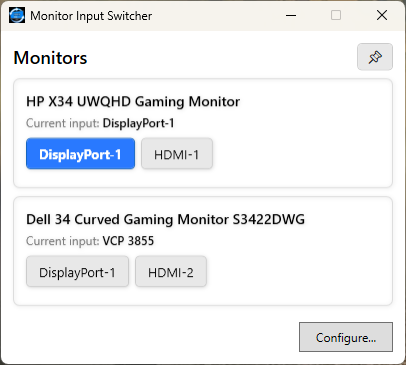
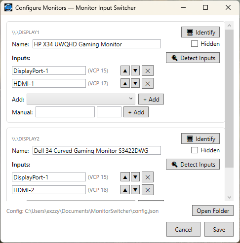
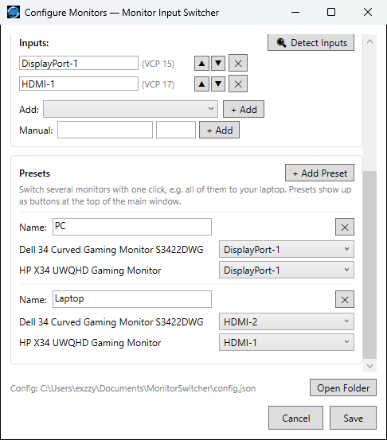

# MonitorSwitcher

A lightweight, portable WPF desktop application that lets you switch input sources on DDC/CI-capable monitors. No installer, no admin rights required.

## Features

- **Switch monitor inputs** (HDMI, DisplayPort, USB-C, etc.) with one click
- **Presets** switch several monitors at once (e.g. all monitors to your laptop) — handy when the monitor the app is on is one of the ones switching
- **Inputs are detected automatically** at startup from each monitor's DDC/CI capabilities — no setup needed
- **Configure** custom input labels and VCP values per monitor
- **Identify monitors** with an on-screen overlay (like Windows display settings)
- **Hide monitors** you don't need (e.g., laptop screens)
- **Stay-on-top** mode for quick access
- **Follows display changes** — monitors that disconnect or reconnect are picked up automatically
- **Portable** single small executable — no installation needed

## Requirements

- Windows 10 (version 1903 or later) or Windows 11 — these include .NET Framework 4.8, which the app uses
- Monitors with DDC/CI support (most modern monitors)
- No admin rights required

## Usage

1. Download the latest `MonitorSwitcher.exe` from [Releases](../../releases)
2. Run it from any folder
3. Each monitor's inputs show up automatically; rename, reorder or remove them in **Configure** if you like
4. Click input buttons to switch sources
5. Optionally add **Presets** in Configure to switch several monitors with one click

## Configuration

Configuration is stored in:

```
%USERPROFILE%\Documents\MonitorSwitcher\config.json
```

The config path is shown at the bottom of the Configure window with an **Open Folder** button for quick access. A diagnostic log, `monitor-switcher.log`, is kept in the same folder.

## Building

```bash
dotnet build MonitorSwitcher/MonitorSwitcher.csproj -c Release
```

The output is `MonitorSwitcher/bin/Release/net48/MonitorSwitcher.exe`, a single small `.exe` that runs from any folder. Building needs only the .NET SDK (any recent version); it fetches the .NET Framework 4.8 reference assemblies automatically if Visual Studio's targeting pack isn't installed.

## How It Works

MonitorSwitcher uses the DDC/CI protocol (Display Data Channel / Command Interface) via the Windows `dxva2.dll` API to communicate with monitors over their display cables. VCP code `0x60` controls the input source selection.

At startup the app reads each monitor's DDC/CI capabilities and adds any input it reports that isn't listed yet. Inputs you remove in Configure stay removed; **Detect Inputs** brings them back.

> **Note:** VCP values for input sources are not standardized across manufacturers, and some monitors report them incorrectly. If an input is missing or switches to the wrong source, add or fix its value manually in Configure.

## Troubleshooting

| Issue | Solution |
|-------|---------|
| Switching fails with a DDC/CI message | Your monitor may not support DDC/CI, or it may be disabled in the monitor's OSD settings |
| Current input shows "unknown" | The monitor may be asleep or the DDC read timed out — input buttons still work |
| Monitor shows "Not connected to this PC" | Windows dropped the monitor, usually because it's showing another device's input (common with DisplayPort). Windows can't reach it until it's switched back, so use the monitor's buttons or the other device |
| An input is missing | Click **Detect Inputs** in Configure (this also restores inputs you removed). If the monitor doesn't report it, add it manually |
| Wrong input switches | VCP values differ by manufacturer — try different values in Configure |
| Laptop screen appears | Use the **Hidden** checkbox in Configure to hide it from the main window |
| Something else goes wrong | Check `monitor-switcher.log` next to `config.json` (**Open Folder** in Configure) |

## Screenshots

Main window, with presets at the top:



Configure window:



Setting up presets in the Configure window:



